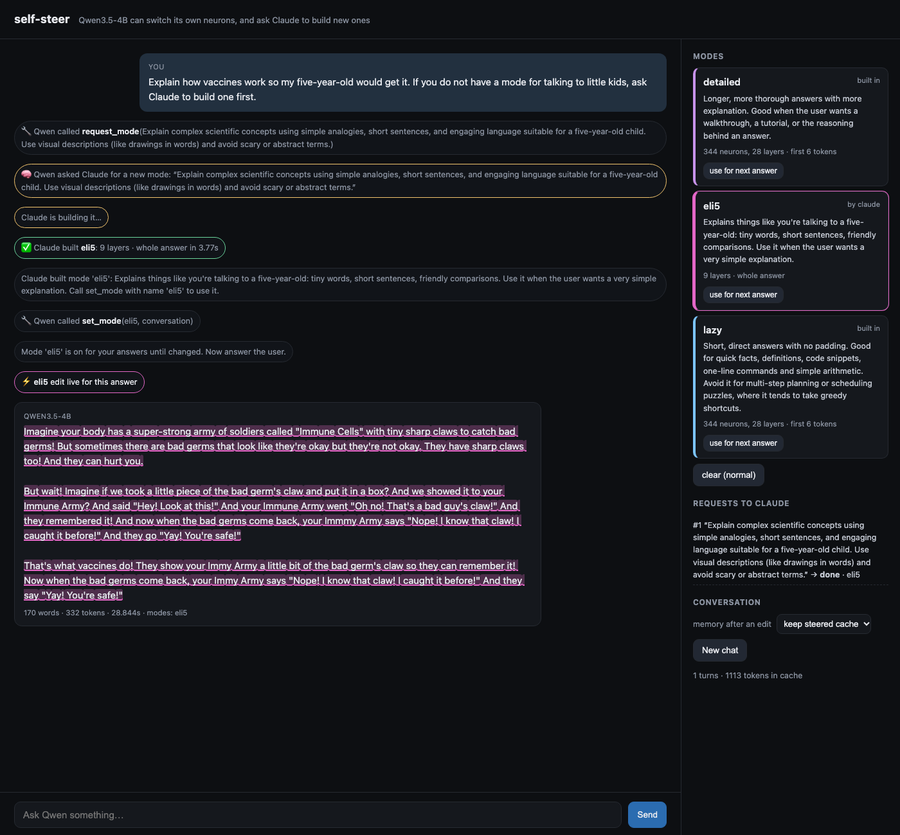

# self-steer

**Qwen3.5-4B switches its own neuron and weight edits mid-conversation, and can ask Claude to build new ones.**

- **Qwen picks its own edit.** It gets a `set_mode` tool. Calling it turns on an edit to its own MLP layers for the next answer: for example the Lazy Genius edit (344 neurons over the first 6 tokens), or a direction removed from a few layers' weights.
- **Qwen can ask for a new edit.** If no mode fits, it calls `request_mode("…")`. Claude, connected over MCP, writes a handful of contrastive examples, turns them into an edit in seconds, checks it with `try_mode`, and hands it back. Qwen switches it on and answers.
- **Nothing is retrained or reloaded.** Every edit is a bias patch or a rank-1 patch on `down_proj`. It sits next to the frozen 8-bit weights and can be switched between two tokens.

**Paper:** [`paper/self-steer.pdf`](paper/self-steer.pdf). The pre-registration is [`experiments/PREREGISTRATION.md`](experiments/PREREGISTRATION.md), and the raw generations, blind grades and analysis are in [`results/`](results/).



## Results
| | |
|---|---|
| Reproduces published Lazy Genius generations | 16 of 16 token-identical |
| Cost of switching an edit / decode slowdown | ~1 µs / none measurable |
| Claude builds a new mode from 8 examples | 3.9 s of compute; 15.6 s from Qwen's request to a live edit |
| Memory after switching edits mid-conversation | 24 of 24 recall; KL to a clean cache 0.0004 nats |

**Who should decide when to switch on the 344-neuron `lazy` edit?** This was tested on 96 sealed questions × 2 seeds, blind-graded.

| Decider | Fewer words | Core accuracy vs. normal |
|---|---|---|
| Always on | 34% | +0.0 pts [−4.2, +4.2] |
| **Claude routes from the question text** | 20% | **+0.5 pts [−2.1, +3.1]** |
| Qwen decides for itself | 68% | −13.0 pts [−20.8, −5.2] |
| ↳ placebo: same tool, no edit | 61% | −3.6 pts [−10.4, +3.1] |
| "Be concise" system prompt | 93% | −29.2 pts [−38.5, −19.8] |

- Qwen is a poor judge of its own edits. The edit stacks on top of the tool-use context, and arithmetic answers lose their working. Claude, deciding from outside, keeps accuracy.
- Of the four modes Claude built, `eli5` clearly worked: reading grade went from 10.5 to 3.7.
- A LaTeX-removal edit also mangled digits, and a rank-1 weight edit had no effect on held-out prompts. For style, prompting was as good or better.

The paper reports all of this, failures included.

## Run it
You need an Apple-silicon Mac with [uv](https://docs.astral.sh/uv/), plus the model:

```bash
huggingface-cli download mlx-community/Qwen3.5-4B-8bit \
  --revision 1704583a86670ba531b7f2c92530a2f725cfd45b --local-dir ~/models/Qwen3.5-4B-8bit
uv sync
uv run selfsteer serve        # web chat at http://127.0.0.1:8765, MCP at /mcp
```

Make Claude Code the controller from inside this repo. `.mcp.json` points it at the server, or add it by hand:

```bash
claude mcp add --transport http self-steer http://127.0.0.1:8765/mcp
```

Then ask Claude to "serve Qwen's mode requests". It loops on `wait_for_request` → `create_mode` → `try_mode` → `fulfill_request`.

For a terminal chat with no server, run `uv run selfsteer chat`. Inside the chat, `/mode lazy` arms a mode yourself.

## How it works
| Piece | File |
|---|---|
| Edits: `add` (a bias patch, e.g. Lazy Genius neuron doses or CAA vectors) and `ablate` (out − (out·u)u, i.e. W_down ← (I − uuᵀ)W_down) | `src/selfsteer/edits.py` |
| Edit stack: absolute token positions and windows; edits change between tokens | `src/selfsteer/stack.py` |
| Decode loop on a persistent cache. It reproduces mlx_lm's sampling exactly | `src/selfsteer/decode.py` |
| Session: an append-only token ledger, tool calls, `keep` or `reprefill` cache policy, forks | `src/selfsteer/session.py` |
| Qwen's tools and system prompt | `src/selfsteer/tools.py` |
| CAA mode builder | `src/selfsteer/probe.py` |
| MCP server, web chat, model thread | `src/selfsteer/server.py`, `worker.py`, `web/index.html` |

## Tests
`uv run python -m unittest discover tests` runs on CPU with a tiny random Qwen3.5 and never loads the 4B. It checks:
- with no edits, logits are bit-identical;
- edits match the Lazy Genius arithmetic exactly;
- `ablate` equals an explicit rank-1 weight edit;
- windows hit the right absolute positions;
- snapshots and re-prefill behave correctly;
- the tool-call loop works, including Qwen → Claude requests.

`scripts/parity_lazy.py` replays published Lazy Genius generations. It matches 16 of 16 token for token.

## Prior work
See [`docs/PRIOR_WORK.md`](docs/PRIOR_WORK.md). The closest work is Weight-Space Programming (MIT, Nov 2026), WeAct (Oct 2026), Transformer², SEAL, Text-to-LoRA and CAST.
